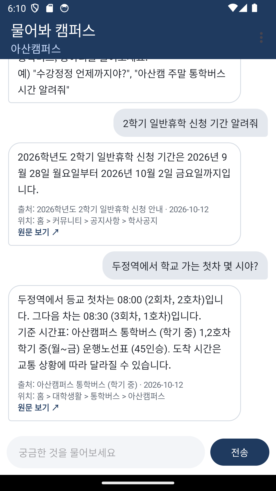
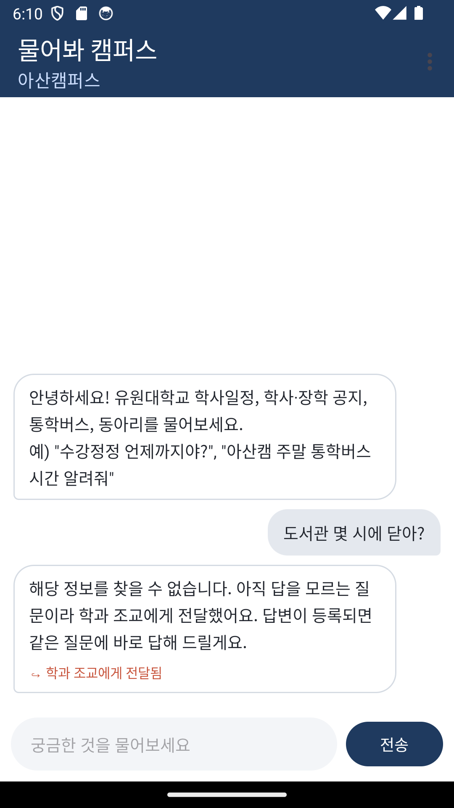
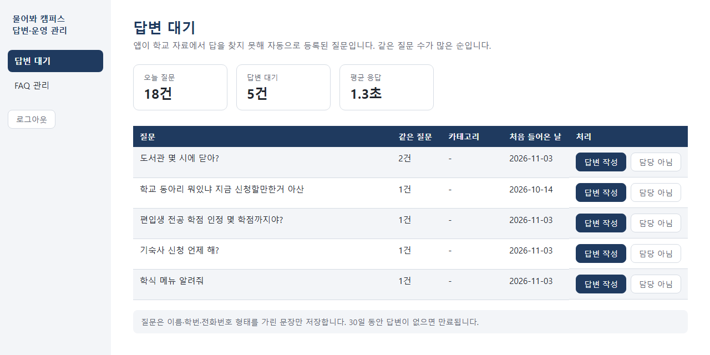

# 물어봐 캠퍼스 중간 현황 보고서

- 과제명: 물어봐 캠퍼스 (Ask Campus): RAG와 sLLM 기반 캠퍼스 정보 질의응답 앱
- 팀: 캡스톤디자인 1조 (조장 22026018 송승현, 조원 22126008 이승우)
- 보고일: 2026-11-10 (계획서 15주 일정 중 9주차)
- 보고 범위: 2026-09-14 ~ 2026-11-10
- 기준 문서: 요구사항 정의서 v1.11, 화면설계서 v1.5, DB 모델링 v1.0, API 명세서 v1.0
- 시험 결과는 모두 보고일에 서버와 평가 스크립트를 다시 실행해 측정한 값입니다.
- 이전 판: 8주차 보고서(11/03). 이번 판에는 평가 질문셋 측정, sLLM 비교 시험, 답변 품질 수정, 계획 변경을 더했습니다.

## 1. 한눈에 보기

> **학교 정보는 있는데, 못 찾는다.**
> 물어봐 캠퍼스는 학교 홈페이지 자료만을 근거로 답하고, 모르는 질문은 지어내지 않고 조교에게 넘깁니다. 조교가 단 답은 다음 학생의 답이 됩니다.

| 구분 | 현황 |
|---|---|
| 단계 | 분석·설계를 마쳤습니다. 핵심 흐름이 동작하는 MVP를 만들었고, 지금은 성능을 측정하며 모델을 확정하고 있습니다 |
| 직접 잰 수치 | 검색 정확도(정답 근거가 상위 3개 안에 든 비율) **98.8%**(79/80, 목표 80%), 조교 답변 흐름 9/9, 통학버스 시간 계산 10/10, sLLM 답변 평균 2.1~3.5초 (목표 5초) |
| sLLM 선정 | 후보 3개를 같은 질문으로 시험해 **Kanana 1.5 2.1B 유지** (답 있는 질문 12/12) |
| 요구사항 진척 | 기능 33개 중 구현 7, 일부 구현 14, 미착수 12 |
| 계획 변경 | 조교 인터뷰와 2차 설문은 하지 않기로 함 (11/10 팀 결정) |
| 가장 큰 지연 | 파인튜닝 (계획 7주차, 미착수) |

## 2. 문제: 정보는 있는데 못 찾는다

시험 기간에 신입생이 "기말고사 언제야?"를 알고 싶다고 해 봅시다. 답은 학교 홈페이지에 있지만, 학사일정 메뉴를 알아야 찾을 수 있습니다. 같은 학생이 "폐강된 과목은 언제 정정해?"를 찾으려면 이번엔 학사공지 게시판을 뒤져야 합니다.

| 근거 | 내용 |
|---|---|
| 1차 사전 설문 (9명) | 포털이 불편하다(검색·메뉴) **78%**, 앱을 쓰겠다 **89%** |
| 수집하며 확인한 자료 위치 | 공지는 게시판 3곳(학사·일반·장학)에, 학사일정·통학버스·동아리는 각각 다른 메뉴에 흩어져 있음 |

설문 응답자가 모두 아산캠퍼스이고 수가 적어서, 방향을 잡는 참고로만 씁니다.

## 3. 원인: 왜 기존 방식으로는 안 되나

- **포털 검색**은 게시판마다 따로 찾아야 하고, 제목에 들어간 단어가 맞아야 결과가 나옵니다. "다음 학기 복학 언제야?" 같은 말로는 찾기 어렵습니다.
- **ChatGPT 같은 범용 AI**는 우리 학교의 최신 공지와 통학버스 시간표를 모릅니다. 모르는 것을 그럴듯하게 지어낼 수도 있습니다.

| 비교 | 포털 검색 | 범용 AI (ChatGPT 등) | 물어봐 캠퍼스 |
|---|---|---|---|
| 우리 학교 최신 자료 | O (흩어져 있음) | X | O (한곳에 모아 검색) |
| 말로 묻기 | X (단어 일치) | O | O |
| 출처·원문 확인 | O | X | O (출처 최대 3개, 원문 보기, 메뉴 위치) |
| 모를 때 | 결과 없음 | 지어낼 수 있음 | "찾을 수 없습니다" + 조교에게 전달 |
| 질문이 외부로 나감 | 해당 없음 | 나감 | 안 나감 (모델을 노트북에서 실행) |

## 4. 해결: 사용 장면별 동작

| 장면 | 동작 | 확인 |
|---|---|---|
| ① "2학기 기말고사 언제야?" | 학사일정에서 찾아 "2026년 12월 8일부터 12월 14일까지"로 답하고, 출처와 원문 링크를 붙임 | 11/10 비교 시험 |
| ② "기숙사 신청 언제 해?" (자료에 없음) | "찾을 수 없습니다"라고 답하고 질문을 답변 대기에 등록함. 조교가 답하면 같은 질문과 비슷한 질문에 바로 그 답이 나감 | 조교 답변 흐름 9/9 |
| ③ "방금 두정역에 도착했는데 가장 빠른 버스?" | 현재 시각과 평일·주말을 따져 서버 코드가 다음 차를 계산함 (sLLM 안 씀) | 시간 계산 10/10 |

<div class="figrow" markdown="1">





</div>



## 5. AI를 쓰는 곳과, 틀리면 막는 방법

AI는 두 곳에서만 씁니다. 질문과 비슷한 자료를 찾는 곳(임베딩)과, 찾은 자료로 문장을 만드는 곳(sLLM)입니다. 답이 정해진 계산과 최종 판정은 코드가 맡습니다.

```
질문
 → ① 검색 (KURE-v1 + Chroma): 유사도가 기준값 0.60보다 낮으면 답하지 않음
 → ② 정해진 계산은 코드로: 통학버스 다음 차 (sLLM 안 씀, 0.04초 안팎)
 → ③ sLLM 답변 (Kanana 1.5 2.1B): 근거 자료에 있는 내용만 쓰도록 지시
 → ④ 후처리: "근거 없음" 표현을 판정하고, 빈 항목·맺음말·HTML을 지움
 → ⑤ 출처 최대 3개 + 원문 보기 + 홈페이지 메뉴 위치를 함께 보여 줌
 → 근거가 없으면 ⑥ 답변 대기 자동 등록 → 조교 답변 → FAQ 즉시 반영 (사람이 최종 답함)
```

- ②와 ④는 실제 오답을 겪은 뒤에 넣은 단계입니다. 자세한 경위는 7.3절에 있습니다.
- **비용:** 모델을 노트북 GPU에서 직접 돌려서, 질문 1건마다 내는 외부 AI 요금이 0원입니다. 전기료는 따로 재지 않았습니다.

## 6. 데이터 출처와 개인정보

### 6.1 데이터

| 자료 | 출처 | 분량 | 수집일 |
|---|---|---|---|
| 학사·일반·장학 공지 | 학교 홈페이지 공개 게시판 | 게시판마다 최근 20건 | 2026-10-12 |
| 학사일정 | 학교 홈페이지 | 일정 66건 (일정 하나 = 청크 하나) | 2026-10-12 |
| 통학버스 | 학교 홈페이지 (영동·아산, 주말·방학) | 페이지 4개 | 2026-10-12 |
| 동아리현황 | 학교 홈페이지 | 1페이지 | 2026-10-12 |

- 전체 청크는 154개입니다.
- 로그인이 필요한 페이지는 수집하지 않았습니다.
- **약점:** 자동 재수집이 없어서 10/12 자료 그대로입니다. 스케줄러를 구현할 때 해결합니다.

### 6.2 개인정보

| 원칙 | 구현 상태 |
|---|---|
| 학생은 로그인 없이 씀. 서버에 이름·학번·기기 ID·IP 칸이 없음 | 구현 |
| 대화 기록은 휴대폰에만 저장 | 설계 완료, 앱 기능은 미구현 (FR-008) |
| 질문을 저장하기 전에 전화번호·학번 형태를 가림 | 구현 |
| 질문 속 이름 가리기 | **미구현.** 방법을 정한 뒤 구현 예정 |
| 질문이 외부 AI 서비스로 나가지 않음 | 구현 (모델·검색 모두 로컬) |
| 답변 대기 30일 뒤 삭제 | **미동작.** 만료일은 저장하지만 처리 작업이 없음. 스케줄러 구현 때 함께 처리 |

## 7. 실현 가능성: 직접 잰 수치

### 7.1 기능 시험 (2026-11-10)

| 시험 | 결과 | 내용 |
|---|---|---|
| 조교 답변 흐름 | **9/9 통과** | 자동 등록 → 비슷한 질문 묶기 → 로그인 → 답변 → 같은 질문에 FAQ로 답변 → 입력 검사 |
| 통학버스 시간 계산 | **10/10 통과** | 시각을 바꿔 가며 가장 빠른 차, 첫차, 막차, 주말, 운행 종료 확인 |
| 대표 질문 | **11/11** | 답 있는 질문 7개는 출처와 함께 답함. 자료에 없는 질문 4개는 근거 없음 + 답변 대기 등록 |
| sLLM 답변 시간 | **평균 2.1~3.5초** (최대 4.8~9.1초) | 목표는 평균 5초(PER-001). 7.3절 sLLM 호출 14회 기준. 임베딩을 GPU에 두면 3.5초, CPU에 두면 2.1초 |
| 시간표 조회 시간 | **0.02~0.04초** | sLLM 안 씀 |

### 7.2 검색 정확도 (평가 질문셋 108개)

평가 질문셋은 세 종류로 나눴습니다.
- 자료에 답이 있는 질문 80개: 학사일정 20, 학사공지 20, 일반공지 15, 장학 12, 통학버스 8, 동아리 5. 그중 구어체가 25개입니다.
- 자료에 없는 질문 20개
- 자료에 일부만 있는 질문 8개

정답 근거 문자열이 실제 수집 자료에 있는지는 평가 때마다 자동으로 다시 확인합니다. 이 측정은 검색 단계만 보며, sLLM은 쓰지 않습니다.

| 지표 | 결과 |
|---|---|
| 상위 1 정답률 | 73/80 (91.2%) |
| **상위 3 정답률 (PER-003, 목표 80%)** | **79/80 (98.8%)** |
| 상위 5 정답률 | 80/80 (100%) |
| 말투별 상위 3 | 구어체 24/25 (96.0%), 정식 55/55 (100%) |
| 실패 1건 | "다음 학기 복학 신청 언제 해?" → 정답(2027학년도 1학기 복학 일정)이 4위. 1위는 지난 2학기 복학 공고 |

근거 기준값(이보다 점수가 낮으면 근거 없음으로 처리)별로 비교했습니다.

| 기준값 | 답 있는 질문을 살림 (80개) | 자료에 없는 질문을 걸러 냄 (20개) |
|---|---|---|
| 0.56 | 76 (95.0%) | 13 (65%) |
| 0.58 | 73 (91.2%) | 14 (70%) |
| **0.60 (현재)** | **72 (90.0%)** | **17 (85%)** |
| 0.62 | 68 (85.0%) | 19 (95%) |
| 0.64 | 61 (76.2%) | 20 (100%) |

**결과를 볼 때 주의할 점**
- **98.8%는 낙관적인 수치입니다.** 질문을 수집 자료를 보면서 썼기 때문에 표현이 자료와 비슷합니다. 실제 학생 질문으로는 아직 측정하지 않았습니다.
- 실제 사용자가 느낄 정확도는 기준값 표에 더 가깝습니다. 지금 0.60에서는 답이 있는 질문 8개가 근거 없음으로 처리되고, 자료에 없는 질문 3개는 걸러지지 않습니다.

### 7.3 sLLM 비교 시험

**후보 선정.** Hugging Face에서 조건 세 가지로 찾았습니다. 노트북 GPU 8GB에 임베딩 모델과 함께 올라갈 것, 한국어를 지원할 것, 라이선스에 문제가 없을 것입니다.

| 후보 | 크기 | 라이선스 | 결과 |
|---|---|---|---|
| Kanana 1.5 2.1B Instruct (현재) | 2.3B | Apache-2.0 | 시험 |
| Midm 2.0 Mini Instruct (KT) | 2.3B | MIT | 시험 |
| Kanana-2 3B Instruct (카카오, 2026-07) | 3.5B | Kanana 전용 (서비스 운영 가능, "Powered by Kanana" 표시 의무) | 시험 |
| Qwen3.5 2B (요구사항 정의서의 비교 모델) | 2.3B | Apache-2.0 | **미시험.** transformers 5.x가 필요해 별도 환경을 준비하다 중단 |
| A.X 4.0 Light, EXAONE 4.0, Llama 3.2, Gemma 4 | | | 제외 (크기 초과, 비상업 라이선스, 한국어 미지원 등) |

**시험 조건**
- 같은 질문 19개를 썼습니다. 답 있는 질문 12개, 자료에 없는 질문 4개, 자료에 일부만 있는 질문 3개입니다.
- 시각은 11/10 14:00으로 고정했고, DB 복사본을 쓰면서 FAQ를 비웠습니다.
- 모든 모델을 같은 조건으로 돌렸습니다. 모델은 압축하지 않은 원본(bf16)으로 GPU에서, 임베딩은 CPU에서 실행했습니다.

| 모델 | 답 있는 질문 (12개) | 자료에 없는 질문 (4개) | 평균 생성 시간 | GPU 사용량 |
|---|---|---|---|---|
| **Kanana 1.5 2.1B** | **12** | 4 | 2.1초 | 4.7GB |
| Midm 2.0 Mini | 11 | 4 | 2.4초 | 5.6GB |
| Kanana-2 3B | 8 | 4 | 1.65초 | 6.6GB |

| 질문 | Kanana 1.5 | Midm 2.0 Mini | Kanana-2 3B |
|---|---|---|---|
| 학습법 공모전 총 상금 얼마야? | 대상 30만원, 최우수상 2명 각 20만원, 우수상 3명 각 10만원 (정답) | 총 상금은 90만원입니다 (오답, 실제 합계 100만원) | 해당 정보를 찾을 수 없습니다 (자료에 있음) |
| 2학기 성적 확인 및 정정 기간 알려줘 | 12월 23일 ~ 12월 29일 (정답) | 12.23 ~ 12.29 (정답) | 해당 정보를 찾을 수 없습니다 (자료에 있음) |

- Kanana-2 3B는 압축하면 결과가 더 나빴습니다. 4bit로는 5/12였고, 자료에 없는 날짜를 지어냈습니다. 8bit로는 10/12였습니다.
- **결론:** 답변 정확도와 라이선스를 기준으로 Kanana 1.5 2.1B를 유지합니다. 다만 질문이 19개뿐이라, Midm과의 1문항 차이는 평가 질문셋 전체로 다시 확인합니다.

### 7.4 오답을 찾아 고친 사례

| 문제 | 원인 | 해결 | 재시험 |
|---|---|---|---|
| "가장 빠른 버스"에 10:15로 답함 (08:00이 맞음) | 시간표 조각 일부만 검색됨, 현재 시각을 모델에 넘기지 않음, 2B 모델이 시간 비교를 못 함 | 시간표 조회를 코드가 계산 (5절 ②) | 10/10 |
| 다른 모델이 "제공되지 않았습니다"라고 답하면 답변 대기에 안 올라감 (11/10 비교 중 발견) | 근거 없음을 정해 둔 문구로만 판정함 | 판정 문구 5개 추가 (5절 ④) | 지난 비교 답에 적용: 정상 답이 근거 없음으로 바뀐 사례 0건 |
| 답변에 빈 칸 "연락처: 010-"과 맺음말이 섞임 | 모델이 자료의 빈 칸과 인사말을 그대로 씀 | 후처리에서 빈 항목·짧은 맺음말·HTML 삭제. 실제 번호가 있는 줄은 남김 | 12/12 유지 |
| 자료에 없는 내용을 지어냄 | 근거 기준값이 낮음 (0.45) | 0.60으로 올림 (5절 ①) | 자료에 없는 질문 17/20 걸러 냄 |
| 등록금 환불 일정 오답 | 학사일정을 월별로 묶어 검색이 빗나감 | 일정 하나를 청크 하나로 분리 | 비교 시험에서 정답 |

개발 환경 문제도 기록했습니다.
- transformers 5.x가 Kanana를 거부했습니다. 4.x로 고정해 해결했습니다.
- GPU 메모리가 부족해 답변에 18~48초가 걸렸습니다. 임베딩을 fp16으로 바꿔 해결했습니다.
- Chroma 첫 입력 직후 검색 오류가 났습니다. FAQ를 SQLite로 옮겨 우회했습니다.
- 모델 다운로드가 중간에 멈췄습니다. 새 전송 방식을 끄고 다시 받아 해결했습니다.

모든 사례는 원인과 해결 과정을 `docs/오류보고서/`에 남겼습니다(개발 8건).

## 8. 진행 현황

### 8.1 일정 대비 진행

| 계획 주차 | 항목 | 현재 상태 |
|---|---|---|
| 1주 | 프로젝트 계획서 | 완료 |
| 3주 | 데이터 수집 및 정리 | **일부 완료.** 수집기와 청크 154개. 교외활동(온통청년 API), 학사요람, 첨부파일 본문은 미수집 |
| 5주 | RAG 파이프라인 | **완료 (1차).** 검색 정확도 첫 측정 완료. 리랭커는 미적용 |
| 7주 | sLLM 선정 및 파인튜닝 | **선정 완료, 파인튜닝 지연** |
| 8주 | 중간고사 | 완료 |
| 9주 | (추가) 평가 질문셋, 모델 비교 | 완료 |
| 10주 | 앱 프론트엔드 개발 및 통합 | **먼저 시작.** 채팅 화면과 서버 연동은 끝났고, 나머지 화면이 남음 |
| 12주 | 구현현황 발표 | 준비 중 (발표 구성안, 예상 질문 21개) |
| 14주 | 판넬 구성 및 전시회 | 예정 |
| 15주 | 최종보고서 제출 및 최종발표 | 예정 |

8주차 보고 뒤(11/03~11/10)에 한 일은 다음과 같습니다.
- 중간 현황 보고서와 발표 자료(14장), 대본 작성
- 평가 질문 108개 작성과 검색 정확도 측정
- sLLM 후보 조사와 3개 모델 비교
- 답변 문제 2건 수정
- 12주차 발표 준비 (다른 발표 사례 분석, 구성안)

### 8.2 완료한 산출물

| 산출물 | 버전·분량 | 주요 내용 |
|---|---|---|
| 프로젝트 계획서 | 제출본 | 목표, 추진 일정, 역할 분담 |
| 1차 사전 설문 | 응답 9건 | 포털 불편 78%, 사용 의향 긍정 89% |
| 요구사항 정의서 | v1.11, 37쪽 | 기능 33개, 유스케이스 15개, 성능 11개, 가용성 9개 |
| 화면설계서 | v1.5, 25장 | 화면 13개, User flow 2개, Logic process 4개 |
| DB 모델링 | v1.0, 20장 | 테이블 13개, 관계 14개, E-R 다이어그램 |
| API 명세서 | v1.0, 9쪽 | 앱 API 5개, 관리 웹 API 13개 묶음, 스케줄러 작업 5개 |
| 발표 자료 | DB·인터페이스 12장, 중간 현황 14장 | 대본 포함 |
| 모델 선정·예산 검토 | 요구사항 v1.11 기준 | 후보 비교, 개발 가능성, 예산 |
| **평가 질문셋·스크립트 (신규)** | 질문 108개, 스크립트 2개 | 검색 정확도 평가, sLLM 비교 시험 |
| 오류·수정 기록 | 설계 E-01~E-28, 개발 8건 | 수정 전후 내용, 원인, 해결 과정 |
| 2차 사전조사 문항 | v11, 14문항 | 작성 완료. **배포하지 않기로 결정** |

설계에서 크게 바뀐 점은 네 가지입니다.
- **조교의 역할:** 학과 조교를 중간 관리자(답변 담당자)로 정했습니다.
- **모르는 질문:** 자동 등록 → 조교 답변 → FAQ 즉시 반영 → 익명 알림으로 이어집니다.
- **조교 로그인:** 이메일 인증 코드 방식입니다.
- **앱 구성:** 채팅 화면 중심으로 줄였습니다.

### 8.3 구성과 기능 요구사항 구현 상태

| 구성 요소 | 사용 기술 | 비고 |
|---|---|---|
| 답변 생성 sLLM | Kanana 1.5 2.1B Instruct | 노트북 GPU(RTX 5060 8GB). 파인튜닝 전 원본 |
| 임베딩 / 벡터 DB | KURE-v1 / Chroma | 청크 154개 |
| 관계형 DB | SQLite | 설계한 13개 테이블 중 4개 구현 |
| 서버 / 조교 웹 | Python FastAPI / Jinja2 | 앱 API 5개 중 3개 구현 |
| 앱 | Android (Kotlin) | Android 8.0 이상, 채팅 화면 |

| 상태 | 개수 | 요구사항 |
|---|---|---|
| **구현** | 7 | FR-001 질의 입력, 003 근거 기반 답변, 004 출처 표시, 005 근거 없음 응답, 007 원문 보기, 010 통학버스, 022 메뉴 위치 |
| **일부 구현** | 14 | FR-002 검색(동의어 사전 없음), 009 설정(캠퍼스만), 011 학사정보·012 동아리(자료 일부), 014 수집(수동 실행), 015 청킹(첨부 제외), 016 벡터 적재(전체 재색인), **018 품질 평가(평가 질문셋·검색 평가만, 8주차엔 미착수)**, 019 API(3/5), 023 캠퍼스(필터 위주), 024 관리 페이지(임시 로그인), 025 통계(기본 지표), 028 자동 등록(알림 토큰 없음), 029 조교 답변(수정·삭제 없음) |
| **미착수** | 12 | FR-006 추천 질문, 008 대화 기록, 013 교외활동, 017 파인튜닝, 020 마감 일정, 021 관심 일정 알림, 026 시설 안내, 027 되묻기, 030 답변 알림, 031 요약 메일, 032 중간 관리자 관리, 033 이메일 로그인 |

설계와 다르게 구현한 부분은 세 가지입니다.

| 항목 | 설계 | 현재 구현 | 이유 |
|---|---|---|---|
| FAQ·답변 대기 임베딩 | Chroma | SQLite에 저장하고 서버가 직접 계산 | Chroma 첫 입력 직후 검색 오류. 건수가 적어 성능 문제 없음 |
| 관리 웹 로그인 | 이메일 인증 코드 | 임시 비밀번호 | 메일 발송 계정 미정 |
| 통학버스 시간 질문 | sLLM이 답변 | 서버 코드가 계산 | 2B 모델이 시간 비교를 못 함. 요구사항 반영 여부는 검토 중 |

## 9. 사용 대상과 운영 지속성

| 항목 | 내용 |
|---|---|
| 사용 대상 | 유원대학교 학생 (영동·아산 캠퍼스). 답변 담당은 학과 조교 |
| 처음 쓸 사용자 | 시범 운영 기간에 팀원과 같은 학과 학생부터 씁니다. 실제 조교 참여가 없으면 팀원이 조교 역할을 맡습니다 |
| 조교 부담 | 비슷한 질문을 하나로 묶고, 같은 질문이 많은 순으로 보여 줘서 한 번 답하면 여러 학생에게 적용됩니다 |
| 서버 | 지금은 노트북 한 대라서 시범 운영 기간을 정해 켭니다. 실제 운영에는 학교 서버나 GPU 서버가 필요하며, 이를 한계로 밝힙니다 |
| 비용 | 지금까지 0원 (공개 모델, 오픈소스, 팀 노트북). 앞으로 최소 0원, 권장 약 3~4만 원(파인튜닝 기간 Colab Pro), 넉넉히 10만 원 이내. 모델 선정·예산 검토 기준 추정치 |

## 10. 한계와 남은 문제

| 문제 | 내용 | 대응 계획 |
|---|---|---|
| **평가 질문이 개발자 작성** | 검색 정확도 98.8%는 자료를 보고 쓴 질문 기준 | 학교 홈페이지 Q&A 게시판의 실제 질문을 추가해 따로 측정 |
| **근거 기준값의 손익** | 0.60에서 답 있는 질문 8개가 걸러지고, 자료에 없는 질문 3개는 통과함 | 잘못 처리된 11개를 확인한 뒤 리랭커 적용이나 기준값 조정 |
| **"다음 학기" 같은 상대 표현** | "다음 학기 복학"에 지난 학기 공고가 1위로 나옴 | 상대 표현을 날짜로 바꿔 검색하거나, 날짜가 가까운 자료를 우선 |
| **구어체 질문을 놓침** | "학교 동아리 뭐있냐 지금 신청할만한거 아산"이 근거 없음 처리됨 (점수 0.552) | 실제 질문으로 측정, 리랭커 |
| **지난 일정 안내** | "수강정정 언제까지야?"에 9월 기간을 답하면서 지났다는 안내가 없음 | 날짜를 코드로 비교해 지난 일정임을 표시 |
| **데이터 갱신** | 10/12 수집본 그대로이고, 공지 3시간 내 반영(PER-008)을 충족하지 못함 | 자동 재수집 스케줄러 |
| **이름 가리기, 30일 만료** | 6.2절 참고 | 스케줄러 구현 때 함께 처리 |
| **방학 시간표** | 방학 기간을 몰라 평일에는 학기 중 시간표로 답함 | 학사일정에서 방학 기간 판정 |
| **Android 전용** | iPhone 사용자는 쓸 수 없음. 2차 설문을 하지 않아 비율도 모름 | Android로 진행하고 한계로 밝힘 |

## 11. 앞으로의 계획

| 시기 | 할 일 |
|---|---|
| 10주 | 근거 기준값 분석 마무리, sLLM 답변 전체 평가(질문 108개), 데이터 재수집 |
| 10주 | 학교 홈페이지 Q&A 게시판의 실제 질문을 평가 질문셋에 추가해 다시 측정 |
| 10~11주 | 리랭커 적용, 임베딩 비교(KURE-v1 vs bge-m3), Qwen3.5 2B 비교(시간이 되면) |
| 10~11주 | Kanana 1.5 파인튜닝 (근거에 충실한 답, 모르면 모른다고 하기, 말투). 같은 질문셋으로 전후를 비교해 좋아졌을 때만 반영 |
| 10~11주 | 자동 재수집, 이메일 로그인·요약 메일, 답변 알림, 되묻기, 추천 질문, 마감 일정 |
| 12주 | 구현현황 발표 (직접 잰 수치와 검증 과정 중심) |
| 13~15주 | 시범 운영, 판넬·전시 준비, 최종보고서 |

**8주차 계획에서 바뀐 점**
- 조교 인터뷰와 2차 설문 배포를 하지 않습니다.
- 실제 학생 질문은 홈페이지 Q&A 게시판에서 모읍니다.
- 시연 때 조교 역할은 팀원이 맡습니다.

| 위험 | 대응 |
|---|---|
| 남은 기능(미착수 12개)에 비해 시간이 부족함 | 우선순위 '상'과 시연 흐름부터 구현. 파인튜닝이 늦어지면 RAG + 프롬프트로 시연 |
| 메일 발송 계정 미정 | 발송 전용 계정을 먼저 만들어 시험 |
| 서버가 노트북 한 대 | 시범 운영 기간을 정해 구동. 외부 접속은 무료 터널 검토 |

**결정이 필요한 사항**
1. (결정됨) sLLM은 **Kanana 1.5 2.1B 유지** (11/10). 임베딩 모델은 비교 후 확정합니다.
2. 근거 기준값을 0.60으로 둘지, 리랭커를 적용할지 (10주차 분석 후)
3. 메일 발송 계정 (Gmail 앱 비밀번호 또는 학교 메일 SMTP)
4. 통학버스 시간 조회를 코드로 처리하는 방식을 요구사항에 반영할지
5. 학교 FAQ(로그인 필요)를 쓸지. 조교 인터뷰를 하지 않으므로, 학과 사무실에 직접 문의할지 이번 범위에서 뺄지

## 12. 마무리

> **학교 정보는 있는데 못 찾는 문제를, 모르면 지어내지 않는 AI와 조교의 답이 쌓이는 구조로 풉니다.**
> 다음 보고까지 실제 학생 질문으로 정확도를 다시 재고, 그 숫자로 12주차 발표를 하겠습니다.
